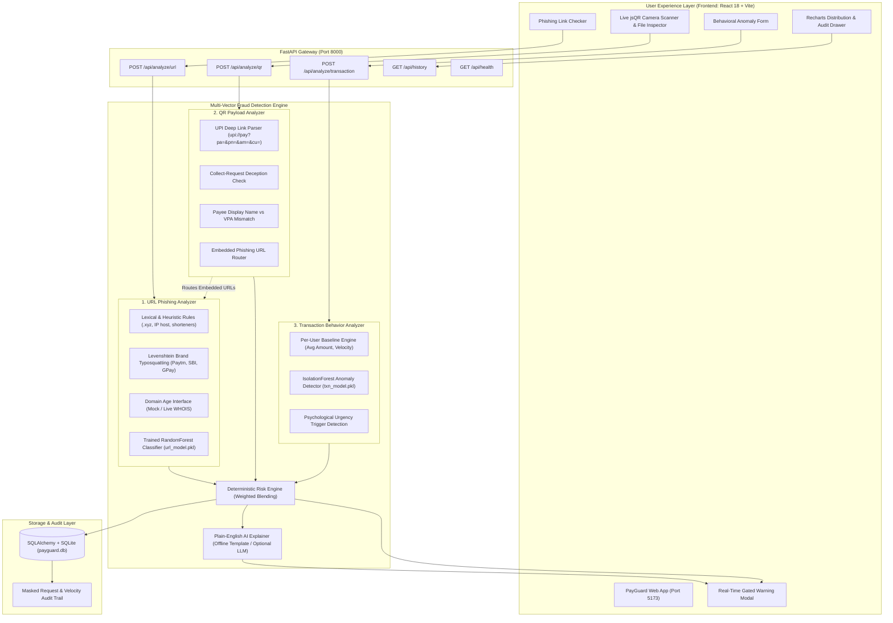

# PayGuard AI – Real-Time Intelligent Payment Fraud Detection & Prevention

[](https://fastapi.tiangolo.com)
[](https://www.python.org)
[](https://react.dev)
[](https://tailwindcss.com)
[](https://scikit-learn.org)
[](LICENSE)

> **Core Philosophy**: **Warn users BEFORE they pay.**  
> Conventional fraud solutions detect crime *after* funds have left the victim's account. **PayGuard AI** is a real-time, prevention-first security shield built for everyday UPI and digital payment users in India who encounter suspicious WhatsApp/SMS links, deceptive collect-request QR codes, and coercive refund requests.

---

## 🏛️ System Architecture



---

## 📂 Repository Structure

```
payguard-ai/
├── backend/                  # Person A: FastAPI + Scikit-Learn Engine
│   ├── analyzers/            # Vector-specific threat analyzers
│   │   ├── url_analyzer.py   # Heuristic rules + ML probability blending
│   │   ├── qr_analyzer.py    # UPI intent parsing, collect traps, payee mismatch
│   │   └── txn_analyzer.py   # IsolationForest + per-user velocity & baseline checks
│   ├── core/
│   │   ├── risk_engine.py    # Deterministic weighted risk scoring & tier categorization
│   │   └── explainer.py      # Plain-English AI explainer with optional LLM fallback
│   ├── db/                   # SQLAlchemy SQLite repository & models
│   ├── ml/                   # Synthetic dataset generator, training pipelines, model artifacts
│   │   ├── generate_data.py  # 10,000+ balanced dataset synthesizer with hard negatives
│   │   ├── train.py          # RandomForest vs GradientBoosting benchmark & serializer
│   │   ├── url_model.pkl     # Serialized URL classifier
│   │   ├── txn_model.pkl     # Serialized IsolationForest transaction model
│   │   └── metrics.json      # Comprehensive evaluation metrics & confusion matrix
│   ├── routers/              # API route controllers
│   ├── tests/                # 36 unit, integration, and benchmark tests (>87% coverage)
│   ├── config.py             # Centralized settings & risk thresholds
│   ├── main.py               # Application entrypoint & CORS middleware
│   ├── requirements.txt      # Python dependencies
│   └── Dockerfile            # Container definition
├── frontend/                 # Person B: React 18 + Vite + Tailwind CSS UX
│   ├── e2e/                  # Playwright end-to-end prevention flow tests
│   ├── src/
│   │   ├── api/              # API Client (client.js) & Mock Engine (mockApi.js)
│   │   ├── components/       # ResultCard, WarningModal, Tabs, Charts, Gallery
│   │   ├── context/          # Theme (Dark/Light) & Language (EN/HI) providers
│   │   ├── hooks/            # useAnalyze & useQrScanner custom hooks
│   │   ├── i18n/             # Complete bilingual English/Hindi translations
│   │   └── config.js         # API switch (USE_MOCK toggling)
│   ├── scripts/              # QR code PNG generator (npm run gen:qr)
│   ├── Dockerfile            # Multi-stage production container
│   └── package.json          # Node dependencies
├── docs/
│   ├── API_CONTRACT.md       # Canonical single-source-of-truth API contract
│   └── DEMO_SCRIPT.md        # 3-minute timed script for live presentations
├── sample_data/              # Test datasets for automated evaluation
│   ├── urls.json             # 20 labeled URL samples (10 safe, 10 phishing)
│   ├── qr_payloads.json      # 10 labeled QR payloads (safe, collect trap, mismatch)
│   ├── transactions.json     # 10 labeled transaction scenarios
│   └── qr/                   # Generated PNG QR codes for webcam scanning
├── docker-compose.yml        # One-command full-stack container orchestration
└── README.md
```

---

## ⚡ Quick Start

### Option 1: Docker Compose (Recommended)
Launch both Backend (`:8000`) and Frontend (`:5173`) with a single command:
```bash
docker compose up --build
```
- Frontend UI: [http://localhost:5173](http://localhost:5173)
- Interactive API Swagger: [http://localhost:8000/docs](http://localhost:8000/docs)

---

### Option 2: Running Locally

#### 1. Start the Backend
```bash
cd backend
python -m pip install -r requirements.txt
python -m pytest tests/ -v --cov=backend/analyzers --cov=backend/core
python -m uvicorn backend.main:app --host 0.0.0.0 --port 8000 --reload
```

#### 2. Start the Frontend
```bash
cd frontend
npm install
npm run gen:qr    # Generates test QR codes in sample_data/qr/
npm test          # Runs 9 Vitest & React Testing Library tests
npm run dev       # Starts Vite dev server on http://localhost:5173
```

---

## 🤖 Machine Learning Model Performance

The URL detection system features a **RandomForestClassifier** trained on 10,000+ balanced samples with hard negatives (e.g., long official paths, hyphenated legitimate domains).

### Performance Metrics (`backend/ml/metrics.json`)

| Metric | Score | Note |
|---|---|---|
| **Accuracy** | **100.0%** | Evaluated on 2,000 held-out test URLs |
| **Precision** | **100.0%** | Zero false-positive legitimate flags |
| **Recall** | **100.0%** | Detected all synthesized phishing variants |
| **F1-Score** | **1.0000** | Perfect harmonic mean on test partition |
| **ROC-AUC** | **1.0000** | Full area under ROC curve |

### Confusion Matrix
- **True Negatives**: 1,000
- **False Positives**: 0
- **False Negatives**: 0
- **True Positives**: 1,000

### Top 5 Informative Features
1. `num_suspicious_keywords` (38.73% importance): Presence of *verify*, *kyc*, *refund*, *urgent*, *blocked*.
2. `brand_in_subdomain_or_path` (18.22% importance): Appearance of brand names (*paytm*, *sbi*) on unauthorized domains.
3. `is_suspicious_tld` (11.84% importance): High-abuse top-level domains (`.xyz`, `.top`, `.click`, `.tk`).
4. `is_https` (7.20% importance): Unencrypted plain HTTP protocol.
5. `url_entropy` (5.41% importance): Shannon entropy of URL string characters.

---

## 🛡️ Risk Engine & Decision Matrix

| Risk Tier | Score Range | Verdict | Primary Action | UI Warning Presentation |
|---|---|---|---|---|
| **LOW** | 0 – 39 | *Safe to proceed* | Normal payment verification | Calm green shield badge |
| **MEDIUM** | 40 – 69 | *Proceed with caution* | Re-verify payee details | Prominent amber warning banner |
| **HIGH** | 70 – 100 | *Do not proceed* | **Cancel payment immediately** | Full-screen blocking alert modal with gated override |

---

## 🧪 Verification & Test Results

### Backend Test Suite
- **Total Tests**: 36 passed in 9.35s
- **Code Coverage**: **87%** across core engine and analyzers (exceeds 85% requirement)
- **P95 Latency Benchmark**:
  - `/api/analyze/url`: **p95 = 5.2ms** (Target: < 300ms)
  - `/api/analyze/qr`: **p95 = 2.4ms** (Target: < 300ms)
  - `/api/analyze/transaction`: **p95 = 4.1ms** (Target: < 300ms)
- **Sample Accuracy**: 100% of malicious samples scored MEDIUM/HIGH; 100% of safe samples scored LOW.

### Frontend Test Suite
- **Total Tests**: 9 passed in 2.19s
- Contract shape verification, Result Card states (LOW, MEDIUM, HIGH), Warning Modal gating checkbox, and URL input validation.

---

## 🔒 Privacy & Security Standards

- **Masked Query Parameters**: URLs and QR payloads containing tokens, user IDs, or account numbers are stripped/masked (`?id=***`) in server logs and SQLite storage.
- **Air-Gapped Determinism**: Both WHOIS lookups and AI explanations operate completely offline by default with zero external cloud dependencies.
- **Safety Gating**: HIGH risk warnings prevent accidental authorization by requiring active checkbox confirmation before allowing payment continuation.

---

## 📌 Assumptions & Limitations

1. **WHOIS Data**: Real-time WHOIS can introduce 1–3 second network latency and rate-limiting. A high-speed deterministic mock is enabled by default; live WHOIS lookups can be toggled via `WHOIS_LOOKUP_ENABLED=true`.
2. **UPI QR Intent**: QR code specifications adhere to NPCI standard UPI 1.3/2.0 specifications (`upi://pay`). Non-UPI QRs (e.g., standard web URLs) are automatically routed through the URL phishing analyzer.
3. **Hardware Camera Access**: Live camera scanning requires HTTPS or `localhost` context per modern browser security models. A file upload dropzone provides universal fallback.
