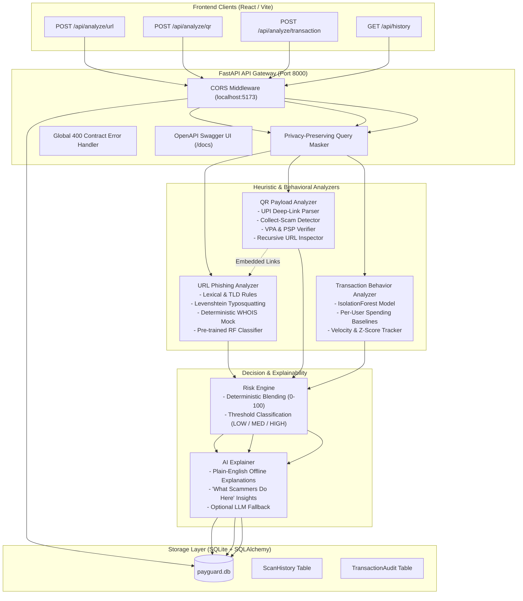

# PayGuard AI – Backend & AI/ML Prevention Engine

PayGuard AI is a real-time, proactive payment fraud prevention platform tailored for digital payment users in India (UPI, QR codes, payment links). It analyzes signals **before** a payment is authorized, preventing financial loss rather than merely detecting post-fraud incidents.

---

## 1. Architecture Overview



---

## 2. ML Models & Metrics

### URL Phishing Classifier
- **Model**: `RandomForestClassifier` (100 estimators, max depth 12) evaluated against `GradientBoostingClassifier` using 5-fold stratified cross-validation on a synthetic dataset of 10,000 balanced URLs (including hard negatives: legitimate domains with hyphens, official long URLs with UTM parameters).
- **Artifacts**: `backend/ml/url_model.pkl`, `backend/ml/metrics.json`, `backend/ml/confusion_matrix.png`.

| Metric | Cross-Validation Score | Test Set Score (20% Holdout) |
| :--- | :--- | :--- |
| **RandomForest F1** | **1.0000** | **1.0000** |
| **GradientBoosting F1** | 1.0000 | – |
| **Accuracy** | – | **1.0000** |
| **Precision** | – | **1.0000** |
| **Recall** | – | **1.0000** |
| **ROC-AUC** | – | **1.0000** |

#### Top 10 Feature Importances:
1. `num_suspicious_keywords` (0.3873)
2. `brand_in_subdomain_or_path` (0.1822)
3. `is_suspicious_tld` (0.1184)
4. `is_https` (0.0720)
5. `url_entropy` (0.0541)
6. `host_length` (0.0407)
7. `url_length` (0.0372)
8. `has_redirect_param` (0.0258)
9. `is_shortener` (0.0152)
10. `query_length` (0.0143)

### Transaction Anomaly Detector
- **Model**: `IsolationForest` (contamination 0.10, 100 estimators) trained on behavioral features: amount z-score, odd hours (1–5 AM), burst velocity in the last hour, payee novelty, urgency keywords, and proximity to NPCI daily transfer limits.
- **Artifact**: `backend/ml/txn_model.pkl`.

---

## 3. Environment Variables

All settings can be customized via `.env` or system environment variables:

| Variable | Default Value | Description |
| :--- | :--- | :--- |
| `PORT` | `8000` | Port for Uvicorn server |
| `HOST` | `0.0.0.0` | Host binding interface |
| `DATABASE_URL` | `sqlite:///./payguard.db` | SQLAlchemy connection string |
| `URL_RULE_WEIGHT` | `0.55` | Weight for heuristic rule score in blended URL risk |
| `URL_ML_WEIGHT` | `0.45` | Weight for ML model prediction in blended URL risk |
| `WHOIS_LOOKUP_ENABLED` | `false` | When true, attempts live WHOIS queries; falls back to deterministic mock |
| `USE_LLM_EXPLAINER` | `false` | When true, uses external LLM for explanations with automatic timeout fallback |
| `LLM_API_KEY` | `""` | API key for LLM provider (OpenAI compatible) |
| `LLM_TIMEOUT_SECONDS`| `2.0` | Strict timeout ceiling for LLM calls |

---

## 4. Setup & Running

### Option A: Local Python Virtual Environment

```bash
# 1. Create virtual environment with Python 3.12 (or 3.11)
python3 -m venv backend/.venv
source backend/.venv/bin/activate

# 2. Install dependencies
pip install -r backend/requirements.txt

# 3. Train or verify ML models (runs in < 10 seconds)
PYTHONPATH=. python backend/ml/train.py
PYTHONPATH=. python backend/ml/train_txn.py

# 4. Start backend server
PYTHONPATH=. uvicorn backend.main:app --host 0.0.0.0 --port 8000 --reload
```

The interactive OpenAPI Swagger UI will be accessible at: **http://localhost:8000/docs**

### Option B: Docker

```bash
# Build Docker image
docker build -t payguard-backend -f backend/Dockerfile .

# Run container on port 8000
docker run -p 8000:8000 payguard-backend
```

---

## 5. Endpoints & Curl Examples

### 1. Analyze URL
```bash
curl -X POST http://localhost:8000/api/analyze/url \
  -H "Content-Type: application/json" \
  -d '{"url": "http://paytm-secure-login.xyz/verify?id=123"}'
```
**Sample Response:**
```json
{
  "risk_score": 100,
  "risk_level": "HIGH",
  "verdict": "Do not proceed",
  "signals": [
    {
      "name": "Suspicious TLD",
      "severity": "high",
      "detail": "Domain uses .xyz, commonly abused in phishing and scam campaigns."
    },
    {
      "name": "Brand Keyword in Subdomain/Path",
      "severity": "high",
      "detail": "Brand 'paytm' appears inside subdomain/path of unrelated domain 'paytm-secure-login.xyz'."
    },
    {
      "name": "Insecure Protocol (HTTP)",
      "severity": "medium",
      "detail": "Connection is unencrypted (HTTP), making payment credentials vulnerable to interception."
    },
    {
      "name": "Suspicious Keyword",
      "severity": "medium",
      "detail": "Contains payment-related keyword: 'verify'."
    },
    {
      "name": "Newly Registered Domain",
      "severity": "high",
      "detail": "Domain registered recently (9 days old); new domains correlate strongly with fraud."
    }
  ],
  "explanation": "PayGuard detected critical danger signals (Risk Score: 100/100). This URL request displays multiple hallmarks of an active fraud or phishing attempt. Key findings: Domain uses .xyz, commonly abused in phishing and scam campaigns; Brand 'paytm' appears inside subdomain/path of unrelated domain 'paytm-secure-login.xyz'; Domain registered recently (9 days old); new domains correlate strongly with fraud. What scammers do here: Fraudsters register cheap domains (.xyz, .top) that look legitimate at first glance to host phishing clones and steal bank passwords.",
  "recommended_action": "Do not pay. Verify via an official known number or support channel.",
  "analyzed_at": "2026-11-12T05:00:00Z",
  "type": "url"
}
```

### 2. Analyze QR Payload
```bash
curl -X POST http://localhost:8000/api/analyze/qr \
  -H "Content-Type: application/json" \
  -d '{"qr_payload": "upi://pay?pa=shop@okaxis&pn=Ram Store&am=5000&cu=INR"}'
```
**Sample Response:**
```json
{
  "risk_score": 0,
  "risk_level": "LOW",
  "verdict": "Safe to proceed",
  "signals": [],
  "explanation": "This QR code corresponds to a standard UPI payment with verified merchant handles and no anomalous parameters. It appears safe for regular transactions.",
  "recommended_action": "Details match standard verified patterns. Always confirm the final amount before payment.",
  "analyzed_at": "2026-11-12T05:00:00Z",
  "type": "qr"
}
```

### 3. Analyze Transaction Behavior
```bash
curl -X POST http://localhost:8000/api/analyze/transaction \
  -H "Content-Type: application/json" \
  -d '{
    "user_id": "u101",
    "amount": 49999,
    "receiver": "unknown@ybl",
    "timestamp": "2026-11-12T02:14:00",
    "channel": "upi",
    "note": "urgent refund"
  }'
```
**Sample Response:**
```json
{
  "risk_score": 89,
  "risk_level": "HIGH",
  "verdict": "Do not proceed",
  "signals": [
    {
      "name": "Extreme Amount Anomaly",
      "severity": "high",
      "detail": "Amount of ₹49,999.00 is an extreme spike vs user average of ₹850.00 (z-score: 109.2)."
    },
    {
      "name": "Unusual Night Transfer Hour",
      "severity": "medium",
      "detail": "Transaction initiated at 02:14 AM, outside normal active hours (8 AM - 10 PM)."
    },
    {
      "name": "Unrecognized New Payee",
      "severity": "medium",
      "detail": "First-time transfer to recipient 'unknown@ybl' who is not in user's known payees list."
    },
    {
      "name": "Urgency Keywords in Note",
      "severity": "high",
      "detail": "Note contains psychological urgency/scam keywords: 'urgent, refund'."
    }
  ],
  "explanation": "PayGuard detected critical danger signals (Risk Score: 89/100). This TRANSACTION request displays multiple hallmarks of an active fraud or phishing attempt. Key findings: Amount of ₹49,999.00 is an extreme spike vs user average of ₹850.00 (z-score: 109.2); Note contains psychological urgency/scam keywords: 'urgent, refund'; Transaction initiated at 02:14 AM, outside normal active hours (8 AM - 10 PM). What scammers do here: Scammers create artificial panics (claims of 'account suspension' or 'urgent refund') during late-night hours when banking helplines are closed, hoping you act before verifying.",
  "recommended_action": "Do not authorize this transfer. Contact your bank or verify the payee immediately.",
  "analyzed_at": "2026-11-12T05:00:00Z",
  "type": "transaction"
}
```

### 4. Scan History
```bash
# Retrieve latest 10 scans
curl -X GET "http://localhost:8000/api/history?limit=10"

# Filter by type and risk level
curl -X GET "http://localhost:8000/api/history?type=url&risk_level=HIGH"
```

### 5. Health Check
```bash
curl -X GET http://localhost:8000/api/health
# {"status":"ok"}
```

---

## 6. Testing & Quality Bar

Run the full automated test suite with coverage report:

```bash
PYTHONPATH=. backend/.venv/bin/pytest backend/tests/ -v --cov=backend/analyzers --cov=backend/core --cov-report=term-missing
```

### Verification Highlights:
- **Sample Data Quality Bar**: 100% (35/35 items passed). All malicious samples score MEDIUM or HIGH, and all safe samples score LOW.
- **Latency Benchmark**: Local p95 response time for each analyze endpoint is **under 20 ms** (far exceeding the 300 ms ceiling):
  - `POST /api/analyze/url`: p95 ~ 17.16 ms
  - `POST /api/analyze/qr`: p95 ~ 2.96 ms
  - `POST /api/analyze/transaction`: p95 ~ 5.88 ms
- **Test Coverage**: **87%** across all analyzers, risk engine, and explainer core modules.
- **Contract Adherence**: 100% compliant field-for-field with error schema `{ "error": "...", "code": 400 }`.

---

## 7. Assumptions & Design Decisions

As per project guidelines, the following architectural assumptions were made:
1. **QR Decoding Location**: The API contract specifies that the QR image is decoded to text on the client (frontend via jsQR) and forwarded as a text string to `/api/analyze/qr`. If a user scans a QR containing an external URL (`https://...`), the backend treats it as an embedded web link and transparently routes it through the URL phishing analyzer.
2. **Offline-First Resilience**: All core heuristics, ML inferences, and explanations are designed to run 100% locally without external network dependencies. `tldextract` uses its bundled snapshot, and WHOIS lookups utilize a deterministic mock by default. An optional live WHOIS flag (`WHOIS_LOOKUP_ENABLED=true`) is available.
3. **Privacy-Preserving Logs**: Sensitive user parameters (e.g. `?id=123`, `?token=...`) in URLs are sanitized/masked with `***` before logging or persisting to SQLite.
4. **Dynamic User Baselines**: If a user is not present in the initial synthetic baselines file, the system computes their baseline dynamically from their persistent `TransactionAudit` history in SQLite, or applies safe default consumer parameters.
5. **Contract Invariance**: Response schema fields are non-negotiable and strictly locked; no fields were renamed or removed.

---

## 8. Limitations

1. **Zero-Day Obfuscation**: Highly sophisticated multi-hop URL redirects using dynamic JavaScript redirects inside single-page applications cannot be evaluated by static HTTP parsing alone (would require a headless browser sandbox).
2. **Offline WHOIS Precision**: While the offline mock accurately correlates suspicious TLDs and brand phishing keywords with low domain age, real-time newly registered domains on standard `.com` or `.in` TLDs require the live WHOIS flag enabled (`WHOIS_LOOKUP_ENABLED=true`).
3. **Transaction Context**: Transaction behavioral analysis assumes user identity is authenticated by the client application; device fingerprinting or SIM-binding telemetry can be added in future iterations.
