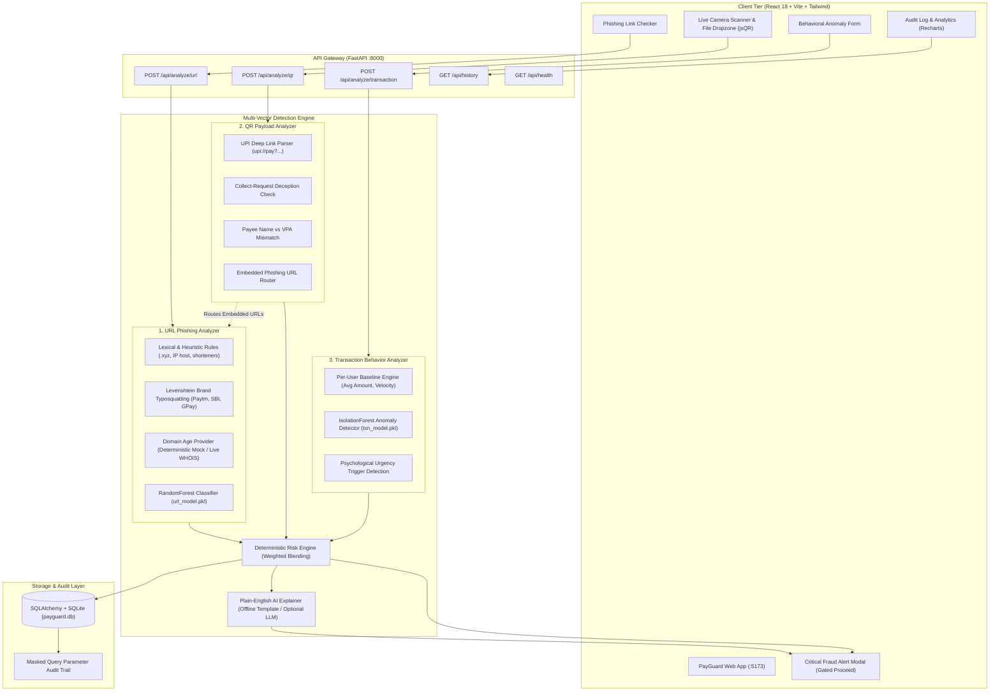

# PayGuard AI – System Architecture & Technical Design

## 1. Overview & Core Philosophy
PayGuard AI is designed around a single principle: **Warn users BEFORE they pay**.
Unlike retrospective anomaly detection systems that flag transactions after settlement, PayGuard intervenes in the user's pre-payment decision loop across three digital attack surfaces:
1. **Unsolicited/Suspicious URLs** (phishing links sent via SMS, WhatsApp, or email).
2. **Deceptive QR Code Payloads** (tampered amounts, payee/VPA mismatches, fake cashback/collect scams).
3. **Behavioral Outlier Transactions** (abnormal amounts, midnight hours, unknown recipients, urgency triggers).

---

## 2. High-Level Architecture Diagram

---

## 3. Component Deep Dive

### 3.1 URL Phishing Analyzer (`backend/analyzers/url_analyzer.py`)
- **Lexical & Structural Rules**: Checks length, dot counts, hyphens, `@` symbols, IP-based hosts, nested subdomains, and punycode (`xn--`).
- **Brand Protection & Typosquatting**: Calculates Levenshtein distance against known Indian banking and e-commerce brands (Paytm, PhonePe, SBI, HDFC, ICICI, Axis, Amazon, Flipkart).
- **Domain Age Interface**: Deterministic mock provider for offline resilience, with optional live WHOIS lookup.
- **Machine Learning**: RandomForestClassifier trained on 10,000+ balanced samples; outputs phishing probability $P(\text{phishing})$.
- **Risk Score Blending**:
  $$\text{Final Score} = \text{round}(w_{\text{rule}} \cdot S_{\text{rule}} + w_{\text{ml}} \cdot (100 \cdot P(\text{ml})))$$
  With overrides for critical multi-high severity signals.

### 3.2 QR Payload Analyzer (`backend/analyzers/qr_analyzer.py`)
- **UPI Deep Link Parsing**: Deconstructs `upi://pay` URI parameters (`pa`, `pn`, `am`, `cu`, `tn`, `mc`).
- **Deception Pattern Matching**:
  - *Collect / Receive Money Tricks*: Flags terms like "enter PIN to receive cashback".
  - *Payee Name vs VPA Mismatch*: Flags VPAs claiming official support on personal or unrelated handles.
  - *Currency & Amount Anomaly*: Flags non-INR currencies and large pre-filled amounts ($\ge \text{₹50,000}$).
- **Recursive URL Inspection**: Embedded URLs in notes or payload text are extracted and piped through the URL Phishing Analyzer.

### 3.3 Transaction Behavior Analyzer (`backend/analyzers/txn_analyzer.py`)
- **Baseline Comparison**: Compares transaction amount against user z-score:
  $$z = \frac{\text{amount} - \mu_{\text{user}}}{\sigma_{\text{user}}}$$
- **Contextual Factors**: Midnight/odd-hour transfers (1:00 AM – 5:00 AM), burst velocity within 1 hour, unrecognized payees, and round-figure amounts.
- **Anomaly Detection**: Scored using a scikit-learn `IsolationForest` model calibrated to continuous anomaly probabilities.

### 3.4 AI Explainer (`backend/core/explainer.py`)
- Generates transparent, non-technical plain-English explanations tailored for everyday users.
- Highlights common scam techniques ("What scammers do here").
- Operates 100% offline via deterministic templates, with optional OpenAI LLM fallback when configured.

---

## 4. Security & Privacy Considerations
- **Query Parameter Masking**: Personal identifiers, tokens, and phone numbers in URL queries are masked prior to storage and logging.
- **Zero External Runtime Dependency**: Core ML and rules run locally in-memory without requiring internet connectivity.
- **Safety-Gated UX**: Full-screen modal blocks navigation on `HIGH` risk until the user explicitly checks the risk acknowledgement.
