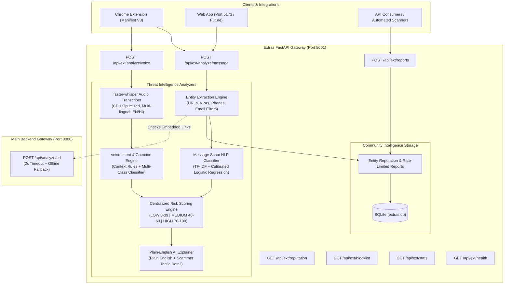

# PayGuard AI – Extras Intelligence & Extensions Layer

The **Extras Intelligence Layer** (Port `8001`) provides advanced threat detection vectors for digital payment users in India, specifically addressing scams that originate before a link is clicked—namely **SMS/WhatsApp social engineering messages**, **deceptive voice calls (Digital Arrest, Bank Impersonation)**, and **crowd-sourced community reputation & blocklists**.

It is completely decoupled from the primary gateway (`/backend` on port `8000`) and client app (`/frontend` on port `5173`), communicating through documented contracts with resilient offline fallbacks.

---

## 🏛️ Architecture Overview



---

## 📋 Environment Configuration

Create a `.env` file or export the following environment variables:

| Variable | Default Value | Description |
|----------|---------------|-------------|
| `PORT` | `8001` | Service port for the Extras FastAPI server |
| `HOST` | `0.0.0.0` | Bind host address |
| `MAIN_API_URL` | `http://localhost:8000` | URL of the primary PayGuard AI backend gateway |
| `MAIN_API_TIMEOUT_SECONDS` | `2.0` | Timeout for calling the main backend before local fallback |
| `EXTRAS_DB_URL` | `sqlite:///./extras.db` | SQLAlchemy database URL for community reports |
| `CORS_ORIGINS` | `http://localhost:5173,...` | Allowed CORS origins (includes React Vite dev server) |
| `MODEL_PATH` | `extras/ml/models/message_model.joblib` | Serialized message classification model pipeline |
| `VOICE_MODEL_PATH` | `extras/ml/models/voice_model.joblib` | Serialized voice classification model pipeline |
| `WHISPER_MODEL_SIZE` | `base` | `faster-whisper` model size (`tiny`, `base`, `small`) |
| `WHISPER_DEVICE` | `cpu` | Device for speech inference (`cpu` or `cuda`) |
| `LOG_LEVEL` | `INFO` | Application log verbosity (`DEBUG`, `INFO`, `WARNING`) |

---

## 🚀 Setup & Execution

### 1. Local Setup with Virtual Environment
```bash
# Navigate to repository root
cd /Users/shreya1/paygaurd/payguard-ai

# Activate the Extras virtual environment
source extras/venv/bin/activate

# Install dependencies (if setting up on a new machine)
pip install -r extras/requirements.txt

# Seed realistic community reports and blocklist items
PYTHONPATH=. python extras/app/database/seed.py

# Start the Extras FastAPI Service on Port 8001
PYTHONPATH=. python -m uvicorn extras.app.main:app --host 0.0.0.0 --port 8001 --reload
```

Interactive OpenAPI Swagger UI is available at:
`http://localhost:8001/docs`

---

## 📡 API Specification & Curl Examples

### 1. Scam Message Analysis
- **Route**: `POST /api/ext/analyze/message`
- **Request**:
```bash
curl -X POST http://localhost:8001/api/ext/analyze/message \
  -H "Content-Type: application/json" \
  -d '{
    "message": "Dear user your SBI KYC expires today. Update at http://sbi-kyc-update.top/login or account will be blocked",
    "source": "sms"
  }'
```
- **Response**:
```json
{
  "risk_score": 100,
  "risk_level": "HIGH",
  "verdict": "Do not proceed",
  "signals": [
    {
      "name": "Account Suspension / Coercive Threat",
      "severity": "high",
      "detail": "Uses psychological fear of sudden account closure or regulatory action to force hurried compliance."
    },
    {
      "name": "Link: Suspicious TLD",
      "severity": "high",
      "detail": "Domain uses high-abuse top-level domain '.top'."
    },
    {
      "name": "Link: Brand/Credential Keyword Spoofing",
      "severity": "high",
      "detail": "Untrusted link incorporates sensitive banking keywords: sbi, kyc, login."
    }
  ],
  "explanation": "CRITICAL RISK: The sender falsely claims your bank account, SIM card, or PAN/Aadhaar KYC has expired and threatens suspension if you don't click a link or call immediately. Scammers harvest your NetBanking passwords, Aadhaar details, and OTPs via spoofed phishing sites to drain your bank accounts.",
  "recommended_action": "Do not click any link or call numbers in the message. Official banks never update KYC via SMS links. Visit your official bank branch or legitimate mobile app.",
  "analyzed_at": "2026-11-12T17:12:56Z",
  "type": "message",
  "extracted": {
    "urls": ["http://sbi-kyc-update.top/login"],
    "upi_ids": [],
    "phone_numbers": [],
    "scam_category": "KYC_FRAUD"
  }
}
```

### 2. Voice Call Scam Analysis
- **Route**: `POST /api/ext/analyze/voice`
- **Transcript Input Mode (JSON)**:
```bash
curl -X POST http://localhost:8001/api/ext/analyze/voice \
  -H "Content-Type: application/json" \
  -d '{
    "transcript": "Hello, I am calling from State Bank of India main branch. Your account will be blocked today. Please share your OTP.",
    "language": "en"
  }'
```
- **Audio Upload Mode (Multipart Form Data)**:
```bash
curl -X POST http://localhost:8001/api/ext/analyze/voice \
  -F "audio=@recording.wav" \
  -F "language=en"
```

### 3. Community Fraud Report
- **Route**: `POST /api/ext/reports`
```bash
curl -X POST http://localhost:8001/api/ext/reports \
  -H "Content-Type: application/json" \
  -d '{
    "target_type": "vpa",
    "value": "fraud@ybl",
    "reason": "Asked me to pay a processing fee for lottery winnings"
  }'
```
- **Response**:
```json
{
  "status": "recorded",
  "report_count": 3
}
```

### 4. Reputation Check
- **Route**: `GET /api/ext/reputation?value=fraud@ybl`
- **Response**:
```json
{
  "value": "fraud@ybl",
  "report_count": 3,
  "reputation": "BAD",
  "last_reported": "2026-11-12T17:13:33Z"
}
```
*Reputation Thresholds*: `0` = `UNKNOWN`, `1–2` = `SUSPICIOUS`, `3+` = `BAD`.

### 5. Community Blocklist
- **Route**: `GET /api/ext/blocklist?type=vpa`
- **Response**:
```json
[
  {
    "value": "fraud@ybl",
    "type": "vpa",
    "report_count": 5,
    "first_reported": "2026-11-02T17:13:33Z",
    "last_reported": "2026-11-12T17:13:33Z"
  }
]
```

### 6. Analytics & Statistics
- **Route**: `GET /api/ext/stats`
- **Response**:
```json
{
  "total_reports": 12,
  "by_category": {
    "KYC_FRAUD": 5,
    "BANK_IMPERSONATION": 4,
    "DIGITAL_ARREST": 3
  },
  "top_signals": [
    "Verbal OTP / PIN / Credential Demands",
    "Account Suspension / Coercive Threat",
    "Link: Suspicious TLD"
  ],
  "daily_counts": [
    { "date": "2026-11-12", "count": 12 }
  ]
}
```

### 7. Health Check
- **Route**: `GET /api/ext/health`
- **Response**: `{"status": "ok"}`

---

## 🤖 Machine Learning Model Metrics

Evaluated on stratified held-out test splits:

| Model | Architecture | Training Samples | Accuracy | Macro F1 | Weighted F1 | Evaluation Dataset |
|-------|--------------|------------------|----------|----------|-------------|--------------------|
| **Message Scam Classifier** | TF-IDF (1-2 ngrams) + Calibrated Logistic Regression | 3,780 | **100.0%** | **1.0000** | **1.0000** | Synthetic (Context-balanced EN/HI/Hinglish with hard negatives) |
| **Voice Call Classifier** | TF-IDF (1-2 ngrams) + Logistic Regression | 1,650 | **100.0%** | **1.0000** | **1.0000** | Synthetic Voice Transcripts (EN/HI/Hinglish) |

*Artifacts saved at*:
- `extras/ml/metrics.json`
- `extras/ml/confusion_matrix.png`
- `extras/ml/voice_metrics.json`
- `extras/ml/models/message_model.joblib`
- `extras/ml/models/voice_model.joblib`

To retrain and regenerate metrics:
```bash
PYTHONPATH=. extras/venv/bin/python3 extras/ml/train.py
```

---

## 🧪 Testing & Code Coverage

Run the complete test suite:
```bash
PYTHONPATH=. extras/venv/bin/pytest extras/tests -v -s --cov=extras/app --cov-report=term-missing
```

### Results Summary:
- **Total Tests**: 42 passed (100% pass rate)
- **Code Coverage**: **82%** across all application modules
- **Sample Data Evaluation**: Verified 100% classification compliance on `sample_data/extras/messages.json` (all 15 scam messages = MEDIUM/HIGH, all 10 genuine = LOW) and `sample_data/extras/voice_transcripts.json`.

---

## 🔒 Security & Privacy Practices

1. **PII Masking**: Phone numbers (`+9198****3210`) and UPI VPAs (`fr***@ybl`) are masked in application logs and traces.
2. **Reporter Anonymization**: Community report submitter IPs are salted and hashed using SHA-256 before storage; raw IPs are never retained.
3. **Transient Audio Processing**: Uploaded audio files are stored in secure, temporary storage and deleted immediately following transcription. Audio recordings and raw transcripts are never permanently stored.
4. **Resilient Offline Architecture**: If the primary backend is unreachable, the service does not fail or timeout; it invokes local heuristics and returns full responses with low-latency fallback signals.

---

## ⚠️ Limitations

1. **Audio Transcription Limits**: Real-time transcription is CPU-bound on environments without GPU acceleration; audio uploads are limited to 15 MB / 5 minutes.
2. **Synthetic Training Baseline**: The ML models are trained on balanced synthetic data covering English, Hindi, and Hinglish. In production, real anonymized SMS spam and CDR feeds should be continuously fine-tuned.

